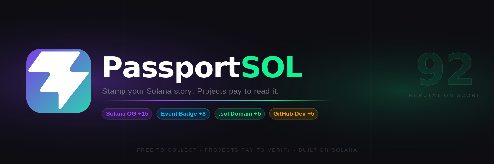
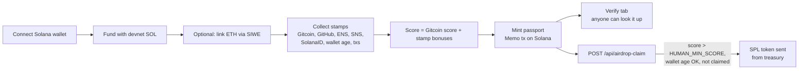

# PassportSOL

A Solana reputation passport: a wallet collects identity "stamps", mints a compact passport on-chain, and anyone can verify it — useful for gating airdrops and community campaigns against bots.




**What you get:** connect a wallet, add proof that you're a real, active user (Gitcoin score, GitHub, ENS, SNS, SolanaID, wallet age, transaction history), and walk away with a passport score written to Solana that any app can check — plus a ready-made SPL token claim flow that only pays out to wallets that pass.

## Features

- **Wallet onboarding** — Solana Wallet Adapter (Phantom etc.), with a devnet faucet step to cover fees.
- **Reputation stamps** — Gitcoin Passport score, GitHub (OAuth device flow), ENS, SNS, SolanaID, wallet age and activity.
- **Optional Ethereum link** — sign in with Ethereum (SIWE via Wagmi) to bring ETH identity into the passport.
- **On-chain passport** — minted (and invalidated) as a Solana Memo-program transaction; no custom program to deploy.
- **Public verify tab** — look up any Solana address and see its passport.
- **Airdrop claim** — serverless route that checks eligibility and sends an SPL token from a treasury wallet.

## How it works



Stamp bonuses live in `src/lib/scoring.ts` (e.g. GitHub/ENS/SNS +5, 2y+ wallet +15, 100+ txs +12). The same scoring function runs in the browser and in the claim API.

On mainnet mode the claim route additionally requires a completed LI.FI bridge for the wallet; on devnet (the default) that check is skipped.

## Quickstart

Requires Node.js 20 (see `.nvmrc`) and a Solana wallet such as Phantom set to **devnet**.

```bash
git clone https://github.com/0jz/passportsol.git
cd passportsol
npm install
cp .env.example .env        # then fill in the values below
npm run dev                 # http://localhost:5173
```

> `npm run dev` serves the frontend only. The `/api/*` routes (GitHub login, airdrop claim) are Vercel serverless functions — run them with the Vercel CLI (`vercel dev`) or on a Vercel deployment.

## Configuration

Copy `.env.example` to `.env`. `VITE_*` variables are bundled into the browser — **never put secrets in them**.

### Frontend (`VITE_*`)

| Variable | Required | Default | Description |
|---|---|---|---|
| `VITE_SOLANA_NETWORK` | No | devnet | Set to `mainnet` to switch cluster and enable mainnet-only rules. Anything else = devnet. |
| `VITE_SOLANA_RPC_URL` | No | public cluster URL | Primary Solana RPC endpoint. |
| `VITE_SOLANA_RPC_FALLBACK` | No | — | Backup RPC used if the primary fails. |
| `VITE_GITCOIN_API_KEY` | For Gitcoin stamp | — | Gitcoin Passport API key. |
| `VITE_GITCOIN_SCORER_ID` | For Gitcoin stamp | — | Gitcoin Passport scorer ID. |
| `VITE_GITHUB_CLIENT_ID` | For GitHub stamp | — | Client ID of a GitHub OAuth app with device flow enabled (public value). |
| `VITE_HUMAN_MIN_SCORE` | No | `5` | Score the UI requires for claim eligibility. Keep equal to `HUMAN_MIN_SCORE`. |
| `VITE_MIN_WALLET_AGE_DAYS` | No | `1` | Minimum wallet age shown in the UI (forced to 0 on devnet). |
| `VITE_MIN_SOL_FOR_CLAIM` | No | `0.002` | SOL balance the UI requires before claiming. |

### Server (Vercel functions in `api/`)

| Variable | Required | Default | Description |
|---|---|---|---|
| `SOLANA_RPC_URL` | Yes (claim) | — | RPC used by the claim route. |
| `AIRDROP_TOKEN_MINT` | Yes (claim) | — | SPL token mint address to airdrop. |
| `CLAIM_TREASURY_SECRET` | Yes (claim) | — | Treasury keypair secret that holds the tokens. **Secret.** |
| `AIRDROP_AMOUNT` | No | `10` | Tokens per claim (in whole tokens; decimals read from the mint). |
| `CAMPAIGN_ID` | No | `devnet-default` | Claim de-duplication key; containing `mainnet` implies mainnet mode. |
| `SOLANA_NETWORK` | No | devnet | `mainnet` enables the LI.FI bridge requirement. |
| `HUMAN_MIN_SCORE` | No | `5` | Claim requires passport score strictly greater than this. |
| `MIN_WALLET_AGE_DAYS` | No | `1` | Minimum wallet age for claims (ignored on devnet). |

`.env.example` also lists `VITE_SOLANA_WS_URL`, `SOLANA_WS_URL` and `GITHUB_CLIENT_ID`; the current code does not read them.

To create a devnet treasury and token mint, follow [docs/DEVNET_AIRDROP_SETUP.md](docs/DEVNET_AIRDROP_SETUP.md).

## Usage

1. Open the app, connect your wallet, and top up from the devnet faucet if prompted.
2. Optionally link an Ethereum wallet, then add stamps (Gitcoin, GitHub, name services…).
3. Click mint — your wallet signs one Memo transaction containing the passport.
4. Use the **Verify** tab to check any Solana address.
5. If eligible, claim the airdrop.

### API routes

| Method | Path | Purpose |
|---|---|---|
| `POST` | `/api/github-device-code` | Proxies GitHub's OAuth device-code request. |
| `POST` | `/api/github-token` | Proxies GitHub's device-flow token exchange. |
| `POST` | `/api/airdrop-claim` | Body `{ solAddress, score, stamps, walletAgeDays }` → eligibility check + SPL transfer. |
| `POST` | `/api/twitter-token` | Proxies Twitter OAuth2 token exchange (not used by the current UI). |

### Scripts

| Command | What it does |
|---|---|
| `npm run dev` | Vite dev server |
| `npm run build` | Type-check (`tsc -b`) and production build to `dist/` |
| `npm run preview` | Serve the production build |
| `npm run lint` | ESLint |

## Project structure

```text
api/                  Vercel serverless functions (GitHub OAuth proxy, airdrop claim)
src/App.tsx           Main flow: wallet → stamps → mint → verify/claim
src/components/       Flow steps (EthStep, StampsStep, PassportView, VerifyPage, …)
src/lib/              Solana memo mint, scoring, Gitcoin, ENS/SNS, SIWE, LI.FI helpers
src/config/campaign.ts  Public eligibility thresholds
public/relay.html     Phantom deep-link return page (mobile)
docs/                 Setup notes, handoff doc, pitch decks, brand assets
vercel.json           SPA + /api rewrites
```

## Deploying

The repo is set up for Vercel: import it, add the environment variables above (server secrets **without** the `VITE_` prefix), and deploy — the frontend and `api/` ship together.

## Status & limitations

- **Devnet-first.** Mainnet mode exists but is not the tested path.
- The claim route trusts the score, stamps and wallet age **sent by the client** — fine for a demo, not sybil-proof.
- Duplicate-claim protection is an in-memory `Set`; it resets on every cold start.
- Mobile wallet flow is deliberately conservative while deep-link return UX is stabilized.
- Treat campaign/claim logic as evolving MVP behaviour.

More background: [handoff notes](docs/PASSPORTSOL_HANDOFF.md) · [LI.FI plan](docs/LIFI_SIDETRACK_PLAN.md) · [pitch assets](docs/pitch/README.md).

## License

No license file is included yet — all rights reserved by the author until one is added.
